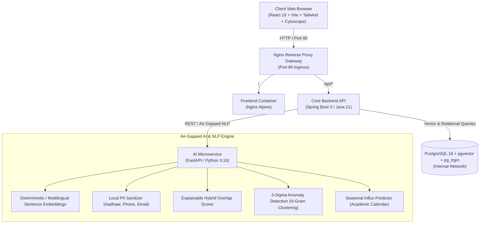

# AICTE Samanvay (समन्वय)
### Air-Gapped Cross-Bureau Grievance Harmonization & Regulatory Oversight Platform

[](https://www.docker.com/)
[](https://spring.io/projects/spring-boot)
[](https://react.dev/)
[](https://fastapi.tiangolo.com/)
[](https://github.com/pgvector/pgvector)

---

## 📌 Overview

**AICTE Samanvay (समन्वय)** is an air-gapped, cross-bureau grievance harmonization, regulatory oversight, and compliance intelligence platform built for the **All India Council for Technical Education (AICTE)**.

It eliminates operational silos between:
1. **PGRC (Public Grievance Redressal Cell)**: Student, parent, and faculty complaints (fee disputes, withheld documents, harassment).
2. **Regulation Bureau**: Approval Process Handbook (APH 2024-27) compliance, intake caps, show-cause notices, and penal actions.
3. **Regional Offices (RO)**: On-site inspections, Expert Visiting Committees (EVC), and territorial tracking.

---

## 🏛️ Architecture



---

## 🌟 14 Key Regulatory Novelties

1. **Explainable Multi-Bureau Overlap Detection**: Transparent hybrid score combining Institution PID, Semantic Cosine Similarity, Category, and Keywords with Pros (+) and Cons (−) explainability factor pills.
2. **Contradictory Directive Engine**: Automatically flags conflicting orders (e.g., one bureau ordering student refund while another freezes status quo).
3. **Cryptographic SHA-256 Hash Chain**: Immutable audit ledger recording every administrative action in a tamper-evident cryptographic block chain.
4. **Air-Gapped Local NLP & PII Sanitization**: On-premise sanitization of Indian phone numbers, 12-digit Aadhaar, emails, and student identity with whistleblower confidentiality protection.
5. **Explainable Delay Risk Forecasting**: Predictive risk levels (Low, Moderate, High, Critical) based on chronic institutional compliance score, SLA proximity, and bureau conflicts.
6. **Regional Root-Cause & 3-Sigma Anomaly Detection**: N-gram phrase clustering that flags systemic institutional malpractices exceeding a $3\sigma$ threshold across regions.
7. **Seasonal Inflow Predictor**: Cyclical grievance forecasting based on academic milestones (admissions, exams, certificate clearances) with resource recommendations.
8. **Cumulative Institutional Index (CII)**: Dynamic institution risk scoring (850 base, Grade A–D) with penalty breakdowns.
9. **Interactive Knowledge Graph**: Cytoscape.js network visualizer mapping relations between institutions, grievances, overlaps, and bureaus.
10. **Multi-Bureau Joint Inquiry Workflows**: Synchronized inquiry coordination, lead bureau assignment, and unified hearings.
11. **Complaint-Splitting Sub-Tasks**: Decomposes composite multi-departmental complaints into coordinated sub-tasks across bureaus.
12. **Reusable Evidence Repository**: SHA-256 verified institutional documents shared across bureaus to eliminate redundant document requests.
13. **Institutional CAPA Tracking**: Monitors time-bound Corrective and Preventive Action undertakings to prevent colleges from defaulting.
14. **Evidentiary Dossier PDF Export**: Exports tamper-evident case dossiers with embedded cryptographic QR codes designed to support electronic record verification under Section 63, Bharatiya Sakshya Adhiniyam, 2023.

---

## 🚀 Quick Start

### Prerequisites
- [Docker Desktop](https://www.docker.com/products/docker-desktop/) installed on Windows / macOS / Linux.

### Run on Windows (One-Click)
Simply double-click or run:
```cmd
run.bat
```
The launcher will:
- Initialize `.env` from `.env.example` if needed.
- Check and launch Docker Desktop if it is not already running.
- Start all 5 microservices in Docker Compose.
- Open the application at [http://localhost](http://localhost).

To cleanly shut down all services at any time:
```cmd
stop.bat
```

### Run with Docker Compose Directly
```bash
# 1. Copy environment configuration
cp .env.example .env

# 2. Build and start containers
docker compose up -d

# 3. View running services
docker compose ps
```

---

## 🌐 Endpoints & Ports

| Service | Internal Port | Ingress URL / Protocol | Description |
| :--- | :--- | :--- | :--- |
| **Web Dashboard** | 80 / 443 | `https://localhost` (or `http://localhost`) | React 18 + Vite Web Console (TLS 1.2/1.3) |
| **Backend API** | 8080 | `https://localhost/api` | Spring Boot 3 Core Services (Java 21) |
| **Public Citizen Tracker** | 80 / 443 | `https://localhost` (Click "Track Grievance") | Air-Gapped Complainant Timeline & OTP Portal |
| **SMS/Email Simulator** | 80 / 443 | `https://localhost` (Bell Menu -> Simulator) | Air-Gapped Outbox Dispatch Monitor |
| **AI NLP Engine** | 8000 | `http://localhost:8000/health` | FastAPI Offline Embeddings, OCR & PII Redaction |
| **PostgreSQL Database** | 5432 | `localhost:5432` | PostgreSQL 16 + pgvector (384-d) + pg_trgm |

---

## 👥 Personas & Role-Based Access Control (RBAC)

- **Apex Administrator (`admin.apex`)**: National headquarters oversight, cross-regional analytics, cryptographic audit chain verification, tamper detection, and national witness key exports.
- **PGRC Officer (`officer.pgrc`)**: Grievance triage, student relief tracking, fee refund directive management, and SLA countdown monitoring.
- **Regulation Bureau Officer (`officer.regulation`)**: APH 2024-27 compliance, institutional intake quota freezes, show-cause notices, and penal enforcement.
- **Regional Officer (`ro.southern`)**: Regional risk heatmaps, territorial jurisdiction isolation, and on-site EVC inspection coordination.
- **Institution Nodal Officer (`nodal.inst`)**: Restricted institutional response portal for viewing non-confidential cases, uploading compliance evidence, and submitting CAPA undertakings.

---

## 🛠️ Verification & Health Check Scripts

The platform includes air-gapped health and compliance test harnesses:

```bash
# 1. Run air-gapped system health check (Verifies services, active embedder, and LLM status)
python scripts/health_check.py

# 2. Verify 100% offline air-gapped isolation (Zero CDNs, local TLS certs, offline flags)
powershell -ExecutionPolicy Bypass -File scripts/verify_offline.ps1

# 3. Seed canonical SIH 2024 demo scenario (Madras Institute of Technology conflict)
psql -U aicte_user -d aicte_samanvay -f scripts/seed_demo_scenario.sql

# 4. Evaluate overlap scoring benchmark (150 complaint pairs, confusion matrix, F1 score)
cd ai-engine && pytest eval/test_overlap_eval.py -v
```

---

## ⚠️ Limitations & Future Scope

In adherence to national engineering integrity standards, the following architectural boundaries and production roadmap are documented:

### 1. Synthetic Benchmark Data
- **Current State**: Seeded institutions and complaints (`db/seed.sql`, `scripts/seed_demo_scenario.sql`) are synthetic scenarios modelled after authentic regulatory cases under AICTE Approval Process Handbook (APH 2024-27). No live student or faculty PII is stored.
- **Future Scope**: Direct integration with real AICTE grievance databases during production deployment following Section 63 BSA compliance audit.

### 2. Heuristic & Statistical Analytics
- **Current State**: Anomaly detection utilizes a Poisson frequency baseline model with a statistical control chart ($z \ge 3.0$). Seasonal forecasting employs empirical admission calendar multipliers derived from historical intake patterns.
- **Future Scope**: Continuous retraining of negative binomial regression models and dynamic Bayes updating as grievance volume scales across academic quarters.

### 3. Required National Government Integrations
- **CPGRAMS (DARPG)**: Integration with the Centralized Public Grievance Redress and Monitoring System API for automated bi-directional synchronization of grievances escalated to the Ministry of Education.
- **AICTE National Approval Portal**: Direct linkage with the institutional approval lifecycle to auto-populate compliance conditions, annual EVC inspection dockets, and approved intake capacities.
- **State Higher Education Portals**: Secure bridge with State Technical Boards and affiliating universities for coordinated fee restitution.

### 4. Enterprise High-Availability & Scaling
- **Database Clustering**: Production deployments across 10,000+ technical colleges require a High-Availability PostgreSQL cluster (Patroni / Citus / pgpool-II) with dedicated read-replicas for pgvector HNSW indexing.
- **Distributed Inference**: Offloading batch OCR (Tesseract) and local LLM drafting (Ollama/llama.cpp) to asynchronous Celery / Redis worker queues on GPU-accelerated edge nodes.

### 5. Hardware Sizing for On-Premise LLM
- **Current State**: The platform ships with bundled statutory high-assurance drafting engines that operate with zero GPU overhead. When optional Ollama local inference is activated, a quantized 1B–3B parameter model (e.g., Llama-3.2-3B-Instruct) requires 8GB–16GB system RAM.

---

## 📂 Project Structure

```
.
├── ai-engine/              # Python FastAPI Air-Gapped NLP Microservice
│   ├── eval/               # Labeled benchmark dataset (150 pairs) & eval scripts
│   ├── main.py             # Multilingual embeddings, Poisson 3-sigma anomaly, Verhoeff PII, OCR
│   ├── requirements.txt    # Python offline dependencies
│   └── Dockerfile
├── backend/                # Spring Boot 3 Core Backend (Java 21)
│   ├── src/main/java/      # Ed25519 crypto, Merkle checkpoints, BCrypt/TOTP MFA, RAG engine
│   ├── src/main/resources/ # aph_clauses.json, application.properties
│   ├── src/test/java/      # 28 comprehensive JUnit 5 & Mockito test suites
│   ├── pom.xml             # Maven configuration
│   └── Dockerfile
├── certs/                  # Self-signed TLS 1.2/1.3 air-gapped certificates
├── db/                     # Database schemas and seed data
│   ├── init.sql            # Schema, pgvector HNSW index, audit chain tables, outbox
│   └── seed.sql            # Synthetic technical institutions and calibrated grievance data
├── frontend/               # React 18 + Vite + Tailwind CSS Single Page App
│   ├── src/components/     # GuidedDemoModal, ComplainantTracking, SmsSimulator, InstitutionPortal
│   ├── src/services/       # api.ts, i18n.ts (EN/HI/TA), docketExport.ts (Section 63 BSA)
│   └── Dockerfile
├── scripts/                # Health checks, offline verifier, demo seeder
│   ├── health_check.py     # Multi-service verification script
│   ├── verify_offline.ps1  # Air-gapped isolation check script
│   └── seed_demo_scenario.sql # Canonical demo scenario seed script
├── docker-compose.yml      # Multi-container orchestration
├── nginx.conf              # Reverse proxy gateway configuration with TLS & security headers
├── run.bat                 # Windows one-click interactive launcher
├── run.sh                  # Linux / macOS shell launcher
└── stop.bat                # Windows clean shutdown script
```

---

## 📜 Legal & Evidentiary Notice
Designed to support evidentiary verification pursuant to **Section 63 of Bharatiya Sakshya Adhiniyam (BSA), 2023** (formerly Section 65B of Indian Evidence Act, 1872). All generated dossiers include digital witness signatures and verifiable cryptographic hash seals.

Developed for the **Smart India Hackathon (SIH)**. All rights reserved.
