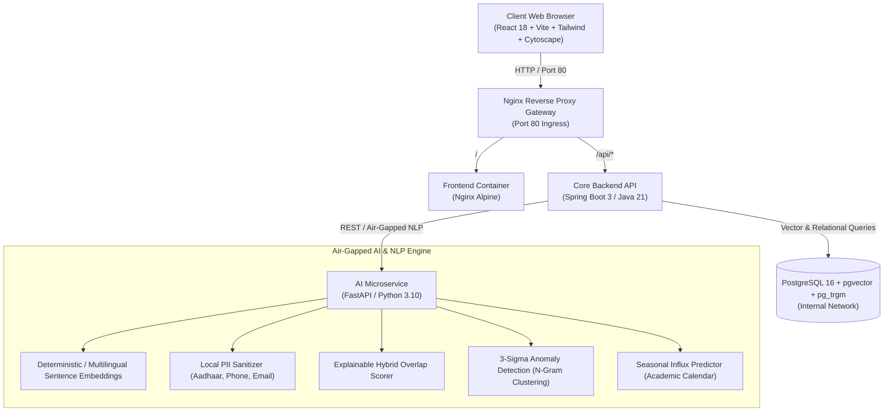

# AICTE Samanvay (समन्वय)
### Air-Gapped Cross-Bureau Grievance Harmonization & Regulatory Oversight Platform

[](https://www.docker.com/)
[](https://spring.io/projects/spring-boot)
[](https://react.dev/)
[](https://fastapi.tiangolo.com/)
[](https://github.com/pgvector/pgvector)

---

## 📌 Overview

**AICTE Samanvay (समन्वय)** is an air-gapped, cross-bureau grievance harmonization, regulatory oversight, and compliance intelligence platform built for the **All India Council for Technical Education (AICTE)**.

It eliminates operational silos between:
1. **PGRC (Public Grievance Redressal Cell)**: Student, parent, and faculty complaints (fee disputes, withheld documents, harassment).
2. **Regulation Bureau**: Approval Process Handbook (APH 2024-27) compliance, intake caps, show-cause notices, and penal actions.
3. **Regional Offices (RO)**: On-site inspections, Expert Visiting Committees (EVC), and territorial tracking.

---

## 🏛️ Architecture



---

## 🌟 14 Key Regulatory Novelties

1. **Explainable Multi-Bureau Overlap Detection**: Transparent hybrid score combining Institution PID, Semantic Cosine Similarity, Category, and Keywords with Pros (+) and Cons (−) explainability factor pills.
2. **Contradictory Directive Engine**: Automatically flags conflicting orders (e.g., one bureau ordering student refund while another freezes status quo).
3. **Cryptographic SHA-256 Hash Chain**: Immutable audit ledger recording every administrative action in a tamper-evident cryptographic block chain.
4. **Air-Gapped Local NLP & PII Sanitization**: On-premise sanitization of Indian phone numbers, 12-digit Aadhaar, emails, and student identity with whistleblower confidentiality protection.
5. **Explainable Delay Risk Forecasting**: Predictive risk levels (Low, Moderate, High, Critical) based on chronic institutional compliance score, SLA proximity, and bureau conflicts.
6. **Regional Root-Cause & 3-Sigma Anomaly Detection**: N-gram phrase clustering that flags systemic institutional malpractices exceeding a $3\sigma$ threshold across regions.
7. **Seasonal Inflow Predictor**: Cyclical grievance forecasting based on academic milestones (admissions, exams, certificate clearances) with resource recommendations.
8. **Cumulative Institutional Index (CII)**: Dynamic institution risk scoring (850 base, Grade A–D) with penalty breakdowns.
9. **Interactive Knowledge Graph**: Cytoscape.js network visualizer mapping relations between institutions, grievances, overlaps, and bureaus.
10. **Multi-Bureau Joint Inquiry Workflows**: Synchronized inquiry coordination, lead bureau assignment, and unified hearings.
11. **Complaint-Splitting Sub-Tasks**: Decomposes composite multi-departmental complaints into coordinated sub-tasks across bureaus.
12. **Reusable Evidence Repository**: SHA-256 verified institutional documents shared across bureaus to eliminate redundant document requests.
13. **Institutional CAPA Tracking**: Monitors time-bound Corrective and Preventive Action undertakings to prevent colleges from defaulting.
14. **Evidentiary Dossier PDF Export**: Exports tamper-evident case dossiers with embedded cryptographic QR codes designed to support electronic record verification under Section 63, Bharatiya Sakshya Adhiniyam, 2023.

---

## 🚀 Quick Start

### Prerequisites
- [Docker Desktop](https://www.docker.com/products/docker-desktop/) installed on Windows / macOS / Linux.

### Run on Windows (One-Click)
Simply double-click or run:
```cmd
run.bat
```
The launcher will:
- Initialize `.env` from `.env.example` if needed.
- Check and launch Docker Desktop if it is not already running.
- Start all 5 microservices in Docker Compose.
- Open the application at [http://localhost](http://localhost).

To cleanly shut down all services at any time:
```cmd
stop.bat
```

### Run with Docker Compose Directly
```bash
# 1. Copy environment configuration
cp .env.example .env

# 2. Build and start containers
docker compose up -d

# 3. View running services
docker compose ps
```

---

## 🌐 Endpoints & Ports

| Service | Internal Port | Ingress URL |
| :--- | :--- | :--- |
| **Web Dashboard** | 80 | [http://localhost](http://localhost) |
| **Backend API** | 8080 | [http://localhost/api](http://localhost/api) |
| **AI NLP Engine** | 8000 | `http://ai-engine:8000/health` (internal) |
| **PostgreSQL Database** | 5432 | `postgres:5432` (internal) |

---

## 👥 Personas & Role-Based Access

- **Apex Administrator**: National headquarters oversight, cross-regional analytics, cryptographic audit chain verification.
- **PGRC Officer**: Grievance triage, student relief tracking, SLA countdown management.
- **Regulation Bureau Officer**: APH compliance, institutional show-cause notices, penal action tracking.
- **Regional Officer**: Regional heatmaps, territorial jurisdiction, on-site EVC inspection coordination.

---

## 📂 Project Structure

```
.
├── ai-engine/              # Python FastAPI Air-Gapped NLP Microservice
│   ├── main.py             # PII masking, 384-d embeddings, delay risk, 3-sigma clustering
│   ├── requirements.txt    # Python dependencies
│   └── Dockerfile
├── backend/                # Spring Boot 3 Core Backend (Java 21)
│   ├── src/main/java/      # Controllers, services, JPA entities, audit hash chain
│   ├── pom.xml             # Maven configuration
│   └── Dockerfile
├── db/                     # Database schemas and seed data
│   ├── init.sql            # Schema, pgvector HNSW index, trigram indexes
│   └── seed.sql            # Realistic technical institutions and grievance data
├── frontend/               # React 18 + Vite + Tailwind CSS Single Page App
│   ├── src/                # Components, Cytoscape graph, PDF generator, API client
│   └── Dockerfile
├── docker-compose.yml      # Multi-container orchestration
├── nginx.conf              # Reverse proxy gateway configuration
├── run.bat                 # Windows one-click launcher
└── stop.bat                # Windows clean shutdown script
```

---

## 📜 License
Developed for the **Smart India Hackathon (SIH)**. All rights reserved.
