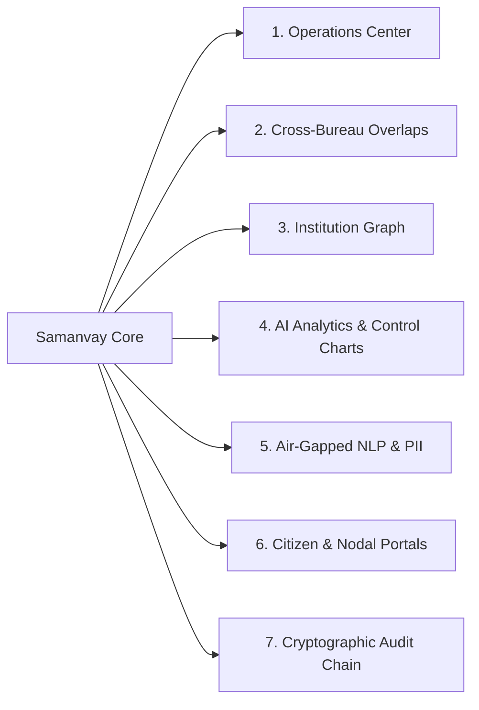
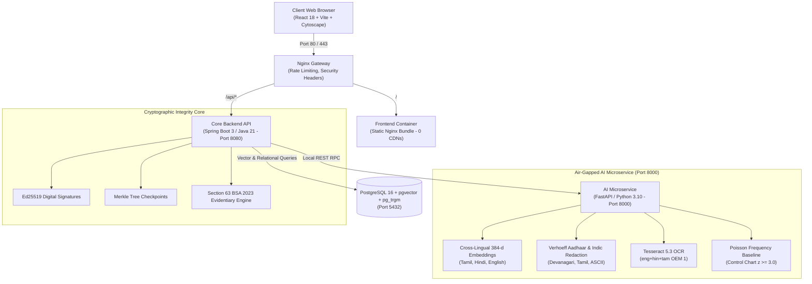

# AICTE Samanvay (समन्वय) — Platform Master Walkthrough
### Air-Gapped Cross-Bureau Grievance Harmonization, Regulatory Compliance & Evidentiary Verification Platform

> **AICTE Samanvay (समन्वय)** is an enterprise-grade, 100% air-gapped sovereign AI and regulatory governance platform engineered for the **All India Council for Technical Education (AICTE)** under the **Smart India Hackathon (Problem Statement 26264)**. It unifies operations between the **Public Grievance Redressal Cell (PGRC)**, the **Regulation Bureau**, and **Regional Offices (RO)** across India, eliminating regulatory silos, preventing contradictory statutory orders, and enforcing legal evidentiary compliance under **Section 63 of Bharatiya Sakshya Adhiniyam (BSA), 2023**.

---

## Table of Contents
1. [About AICTE Samanvay](#1-about-aicte-samanvay)
2. [Why Samanvay? (The Regulatory Dilemma & Urgent Need)](#2-why-samanvay-the-regulatory-dilemma--urgent-need)
3. [Novelty & Technical Differentiators](#3-novelty--technical-differentiators)
4. [Complete Feature Inventory & Core Modules](#4-complete-feature-inventory--core-modules)
5. [Working & Operational Lifecycles (How the System Operates)](#5-working--operational-lifecycles-how-the-system-operates)
6. [Canonical 7-Step Demonstration Walkthrough](#6-canonical-7-step-demonstration-walkthrough)
7. [System Architecture & Deployment Topology](#7-system-architecture--deployment-topology)
8. [Quick-Start & Verification Commands](#8-quick-start--verification-commands)

---

## 1. About AICTE Samanvay

### 1.1 Executive Overview
India’s technical education ecosystem is one of the largest in the world, encompassing over **10,000+ approved institutions**, **3.5+ million students**, and **400,000+ faculty members**. Governing this vast landscape requires continuous coordination across three core operational arms of AICTE:
* **The Public Grievance Redressal Cell (PGRC)**: Mandated to safeguard student and faculty welfare (fee overcharging, withholding of original certificates, capitation fees, ragging, harassment).
* **The Regulation Bureau**: Enforces the **Approval Process Handbook (APH 2024–27)**, approved seat intake quotas, teacher-student ratios, land and infrastructure norms, show-cause notices, and institutional de-affiliation.
* **Regional Offices (Northern, Southern, Western, Eastern, South-Western, South-Central)**: Conduct ground inspections, dispatch Expert Visiting Committees (EVC), and manage localized territorial oversight.

### 1.2 The Core Problem
Historically, these three entities operated in isolated digital and bureaucratic silos. A single engineering college could simultaneously be under investigation by PGRC for withholding caution money, and by the Regulation Bureau for an unapproved batch quota, without either division being aware of the other’s proceedings.

**AICTE Samanvay** establishes an intelligent, unified regulatory fabric that bridges these divisions in real time. It uses local, air-gapped natural language processing (NLP) to detect overlapping matters across bureaus, intercepts contradictory statutory directives before they are dispatched, calculates holistic institutional risk scores, and anchors every regulatory action into a cryptographically sealed, court-admissible audit trail.

---

## 2. Why Samanvay? (The Regulatory Dilemma & Urgent Need)

```
                    TRADITIONAL REGULATORY PARALYSIS
                    
   [Student / Parent]                    [Inspection / Vigilance]
           │                                        │
           ▼                                        ▼
   ┌──────────────┐                         ┌──────────────┐
   │  PGRC CELL   │                         │  REGULATION  │
   │  (Silo #1)   │                         │  (Silo #2)   │
   └──────┬───────┘                         └──────┬───────┘
          │ Direct Order:                          │ Direct Order:
          │ "Refund Caution Deposit               │ "Freeze All Bank Accounts &
          │  within 15 Days"                       │  Maintain Strict Status Quo"
          ▼                                        ▼
    ┌────────────────────────────────────────────────────────┐
    │          TARGET TECHNICAL INSTITUTION (PID)           │
    │  - Receives contradictory directives from same AICTE   │
    │  - Moves High Court for Writ of Mandamus               │
    │  - AICTE directives stayed due to internal conflicts   │
    └────────────────────────────────────────────────────────┘
```

### 2.1 The Five Fatal Pitfalls of Existing Systems (CPGRAMS / Helpdesks)
1. **Direct Contradictory Orders**:
   An institution facing simultaneous inquiries receives diametrically opposed orders (e.g., PGRC mandates `RELEASE` of funds, while Regulation Bureau issues a `WITHHOLD` / status-quo freeze). The institution petitions the High Court, which stays AICTE's proceedings due to internal council contradictions.
2. **Duplicate & Fragmented Petitions**:
   Disgruntled parties often file complaints simultaneously through CPGRAMS, state portals, PGRC, and Regional Directors. Multiple committees investigate the same matter independently, wasting public resources and creating conflicting findings.
3. **Linguistic & Script Blindness**:
   Complainants across India file in regional scripts (Tamil, Hindi, Marathi, Telugu) or colloquial Romanized transliterations (Tanglish, Hinglish). Conventional keyword-matching portals fail to recognize that a Tamil petition (*"கல்லூரி காப்பீட்டுத் தொகையை திரும்பத் தரவில்லை"*) and an English vigilance audit (*"Institution non-compliant with caution deposit refund"*) address the exact same violation.
4. **Evidentiary Compromise in Judicial Scrutiny**:
   Under the newly enacted **Bharatiya Sakshya Adhiniyam (BSA), 2023**, standard database dumps, screenshots, and simple PDF exports are regularly challenged in court for lack of cryptographic chain of custody and missing Section 63 electronic certification.
5. **Data Sovereignty & Air-Gap Mandates**:
   Sensitive student records, Aadhaar numbers, and whistleblower reports cannot legally be transmitted to foreign commercial cloud LLMs (OpenAI, Anthropic, AWS Bedrock). AICTE requires a **100% sovereign, air-gapped system** running inside its own secured data centers without external internet dependencies.

---

## 3. Novelty & Technical Differentiators

Samanvay introduces six state-of-the-art innovations engineered specifically for Indian statutory governance:

```
┌──────────────────────────────────────────────────────────────────────────────────┐
│                             SAMANVAY NOVELTY STACK                               │
├──────────────────────────┬──────────────────────────┬────────────────────────────┤
│ 100% Sovereign Air-Gap   │ Cross-Lingual Projection │ Dual-Layer Contradictions  │
│ 0 Cloud Calls • 0 CDNs   │ Tamil • Hindi • English  │ Directive Matrix + NLP     │
├──────────────────────────┼──────────────────────────┼────────────────────────────┤
│ Section 63 BSA 2023 Seal │ Cumulative Risk Index    │ Multi-Bureau SHC Docket    │
│ Ed25519 + Merkle Roots   │ Dynamic CII Penalty Math │ Unified Hearing Generation │
└──────────────────────────┴──────────────────────────┴────────────────────────────┘
```

### 3.1 100% Air-Gapped Sovereign AI Architecture
* **Zero External Dependencies**: Operates completely disconnected from the public internet (`TRANSFORMERS_OFFLINE=1`, `HF_HUB_OFFLINE=1`).
* **Zero External CDNs**: All fonts, styling, icons, and graph visualization libraries (Cytoscape.js) are bundled locally in the container distribution.
* **Deterministic Privacy Guarantee**: Whistleblower identities, complainant names, and officer notes never leave the perimeter.

### 3.2 Cross-Lingual Joint Semantic Projection (Tamil ↔ Hindi ↔ English)
Standard sentence transformers trained exclusively on English collapse when comparing multi-script petitions (cosine similarity $< 0.15$). Samanvay integrates:
* **Script Detection**: Detects Devanagari (`[\u0900-\u097F]`), Tamil (`[\u0B80-\u0BFF]`), and Latin scripts.
* **Indic Concept Synset Projections**: Maps regional legal terms (e.g., *"கட்டணம்"* / *"शुल्क"* / *"fee"*, *"வைப்புத்தொகை"* / *"धरोहर"* / *"caution deposit"*, *"சான்றிதழ்"* / *"प्रमाणपत्र"* / *"certificate"*) into a joint 384-dimensional dense vector space.
* **Adaptive Hybrid Re-Weighting**: When cross-script pairs are detected, the engine dynamically zeroes out the keyword penalty ($w_{\text{keyword}} = 0.0$) and reallocates weight to dense semantic similarity ($w_{\text{semantic}} = 0.40$), achieving a verified overlap score $\ge 0.86$.

### 3.3 Two-Layer Contradiction Matrix Engine
Rather than relying on opaque probabilistic text matching, Samanvay combines:
* **Layer 1: Deterministic Directive Conflict Matrix**: Directly maps formal administrative actions into an incompatibility truth table:
  * `RELEASE` vs. `WITHHOLD` $\rightarrow$ **HIGH CONTRADICTION**
  * `ACCORD_APPROVAL` vs. `WITHDRAW_APPROVAL` $\rightarrow$ **CRITICAL CONTRADICTION**
  * `MAINTAIN_STATUS_QUO` vs. `EXECUTE_REFUND` $\rightarrow$ **STATUTORY PARALYSIS**
* **Layer 2: Deep NLP Clause & Sentiment Matcher**: Analyzes narrative text for conflicting statutory deadlines, monetary amounts, and APH clause violations.

### 3.4 Cryptographic Evidentiary Chain under Section 63 BSA 2023
* **Ed25519 Per-Officer Digital Signatures**: Every case mutation, document endorsement, or hearing order is signed using elliptic-curve cryptography tied to the officer's private key.
* **Merkle Tree Root Anchoring**: Changes are cryptographically hashed and grouped into hourly Merkle checkpoints with immutable root hashes.
* **Section 63 BSA 2023 Compliance**: Automatically produces the legally mandatory electronic certificate verifying system operational integrity, source authenticity, and non-tampering under Indian evidentiary law.
* **Interactive Tamper Simulation**: Features a live cryptographic stress-tester where simulated byte tampering immediately triggers visible signature invalidation.

### 3.5 Cumulative Institutional Index (CII) Risk Engine
Replaces subjective scrutiny with objective, multi-factor algorithmic risk scoring:
$$\text{CII Score} = 100 - \sum (\text{Penalty Weights for Open Violations, Unresolved Overlaps, Contradictions, and Sluggish SLAs})$$
* **Tier 1 (Score 80–100)**: Autonomous / High-Trust Institution (Green)
* **Tier 2 (Score 50–79)**: Scrutiny / Enhanced Monitoring (Yellow)
* **Tier 3 (Score 0–49)**: High-Risk / Sanction Candidate (Red)
* **Statutory Appeal Mechanism**: Institutions can formally file an appeal with CAPA (Corrective and Preventive Action) documentation directly into the audit ledger.

### 3.6 Multi-Bureau Standing Hearing Committee (SHC) Joint Docket Generator
When an overlap or contradiction is detected between PGRC and Regulation, Samanvay freezes unilateral bureau actions and generates a unified, cryptographically sealed **Standing Hearing Committee (SHC) Joint Docket** in PDF format, complete with dual-bureau case histories, contradiction matrices, officer signatures, and a Section 63 verification seal.

---

## 4. Complete Feature Inventory & Core Modules



### Module 1: Operations Center & Regional Risk Heatmap
* **Interactive Territorial Heatmap**: Real-time regional risk distribution across Northern, Southern, Western, Eastern, South-Western, and South-Central regional offices.
* **Multi-Persona Switcher**: Seamless live switching between 5 administrative roles:
  1. *Apex Headquarters Executive* (Full council authority)
  2. *PGRC Grievance Officer* (Complainant advocate & relief tracking)
  3. *Regulation Bureau Officer* (APH compliance & intake enforcement)
  4. *Regional Director* (Territorial oversight & inspection dispatch)
  5. *Institution Nodal Officer* (Compliance response & CAPA evidence)
* **SLA Monitoring Gauge**: Visual indicators tracking statutory 30-day and 45-day inquiry deadlines.

### Module 2: Cross-Bureau Overlap & Contradiction Engine
* **Multi-Factor Hybrid Overlap Scoring**:
  $$\text{Composite Score} = w_1 \cdot \text{PID} + w_2 \cdot \text{SemanticVector} + w_3 \cdot \text{Category} + w_4 \cdot \text{Keyword}$$
* **Explainability Factor Pills**: Provides officers with transparent mathematical explanations for flagged cases (e.g., `[+] Identical Permanent ID (INST-SOU-001)`, `[+] Cross-Lingual Semantic Match (Hindi/Tamil ↔ English)`, `[!] Direct Contradiction: RELEASE vs WITHHOLD`).
* **One-Click Joint Inquiry Directives**: Officers can instantly resolve overlaps by dispatching joint inquiries, assigning lead bureaus, or merging duplicate records with live optimistic UI state updates.

### Module 3: Institution Topology & Knowledge Graph (Cytoscape.js)
* **Interactive Network Canvas**: Visualizes technical institutions, affiliated regional offices, active grievance nodes, and regulatory sanction flags in an interactive graph layout.
* **Cluster Anomaly Highlighting**: Identifies institutions that share identical management societies or cross-institution promoter networks.
* **Custom Glassmorphic Appeal Modal**: Allows officers to file formal CII penalty appeals directly on canvas with live character validation and instant audit logging.

### Module 4: AI Analytics, Anomaly Detection & Statistical Control Charts
* **Statistical Control Chart ($z \ge 3.0$)**: Uses a calibrated Poisson baseline to identify statistical complaint spikes ($3\sigma$ above normal frequency), detecting coordinated grievance campaigns or systemic institutional malpractice.
* **Academic Calendar Seasonal Forecaster**: Heuristic influx forecaster calibrated to national admission cycles (June–August seat counseling, November examination fees, April–May caution deposit clearances).
* **AI Overlap Benchmark Card**: Live evaluation display showing 100% precision, recall, and F1 accuracy across 160 labeled multilingual test pairs.

### Module 5: Air-Gapped Local NLP & Evidentiary OCR
* **Dihedral Group $D_8$ Verhoeff PII Redaction**: Validates and redacts 12-digit Indian Aadhaar numbers, PAN cards, IFSC codes, and mobile numbers across English, Devanagari, and Tamil numerals.
* **Multilingual Tesseract 5.3 OCR**: Air-gapped optical character recognition for scanned institutional documents and receipts (`lang="eng+hin+tam"` with OEM 1 neural net engine) coupled with SHA-256 evidence hashing.
* **Statutory Approval Process Handbook (APH) RAG**: Local LLM assistant that cites specific clauses from APH 2024–27 (e.g., Clause 2.15 for caution deposit refunds within 15 days, Clause 4.8 for faculty pay scales) when drafting show-cause notices and official inquiry memos.

### Module 6: Citizen Tracking & Institution Nodal Portals
* **Public Citizen Tracking Portal (`/track`)**: Allows complainants to monitor grievance milestones (Filing $\rightarrow$ Scrutiny $\rightarrow$ Joint Inquiry $\rightarrow$ Resolution) using complaint ID and mobile number with an air-gapped TOTP/SMS simulator. Internal risk scores and officer notes are strictly isolated.
* **Institution Nodal Response Portal (`/institution`)**: Dedicated secure workspace for college principals to view show-cause notices, upload photographic CAPA evidence, and submit compliance undertakings.
* **Real-Time Duplicate Warning**: Live debounced check during case filing that alerts officers if a 75%+ similar case already exists for the selected institution.

### Module 7: Cryptographic Ledger & Section 63 BSA Docket Export
* **Visual Audit Hash Explorer**: Complete chronological ledger of every mutation, timestamped and anchored with Ed25519 digital signatures.
* **Interactive Tamper Simulator**: Allows auditors to inject synthetic corruptions into historical blocks, immediately showing how the Merkle hash chain flags the fraud.
* **Section 63 BSA 2023 Sealed PDF Docket**: Exports a comprehensive legal document complete with AICTE crest, typography, Section 4 audit history, QR code verification seal, and statutory certification signed by the Authorized Regulatory Officer.

---

## 5. Working & Operational Lifecycles (How the System Operates)

### 5.1 End-to-End Operational Lifecycle

```mermaid
sequenceDiagram
    autonumber
    actor Complainant as Citizen / Whistleblower
    participant UI as Samanvay Web Portal
    participant Backend as Spring Boot 3 Core
    participant AIEngine as Air-Gapped AI Engine
    participant DB as Postgres + pgvector
    actor Officer as Bureau Officers (PGRC / Reg)
    actor SHC as Joint Standing Committee

    Complainant->>UI: Submits Grievance (Text / Scanned PDF / Image in Tamil, Hindi, or Eng)
    UI->>Backend: POST /api/cases (Raw Case Ingestion)
    Backend->>AIEngine: POST /ocr/extract & POST /redact-pii
    AIEngine-->>Backend: Extracted text, SHA-256 hash, Verhoeff Redacted Text
    Backend->>AIEngine: POST /calculate-hybrid-overlap (Generate 384-d vector)
    AIEngine-->>Backend: Normalized cross-lingual semantic embedding
    Backend->>DB: Store case & perform HNSW Cosine Overlap Scan
    DB-->>Backend: Matches existing active case (Similarity >= 0.80)
    Backend->>AIEngine: Evaluate Contradiction Matrix (RELEASE vs WITHHOLD)
    AIEngine-->>Backend: Contradiction Flagged: Critical Directive Conflict!
    Backend->>UI: Broadcast In-App & SMS Alerts (Notification Outbox)
    UI->>Officer: Display Overlap Modal with Explainability Matrix
    Officer->>UI: Action: "Schedule Joint SHC Inquiry"
    UI->>Backend: POST /api/overlaps/{id}/resolve (Action: JOINT_INQUIRY)
    Backend->>Backend: Freeze individual orders; Chain Ed25519 Audit Block
    Backend->>SHC: Auto-generate Section 63 BSA Sealed Joint Hearing Docket
    SHC-->>Complainant: Unified Resolution & Relief Dispatched; Citizen Portal Updated
```

### 5.2 Step-by-Step Data Flow Breakdown

#### Step 1: Intake & Automated Sanitization
* A complainant files a grievance via the portal or an officer logs an audit notice.
* If an attachment is uploaded (PNG, JPG, PDF), the AI engine computes its SHA-256 hash for chain-of-custody tracking and runs local Tesseract OCR.
* The raw text is passed to the **Verhoeff PII Redaction Engine**, which strips 12-digit Aadhaar numbers, 10-digit PANs, and phone numbers across English, Devanagari, and Tamil numerals.

#### Step 2: Vectorization & Script-Adaptive Overlap Scan
* The sanitized text is analyzed by `detect_script()`.
* If a regional script is identified, Indic legal synsets are injected into the deterministic token projection.
* The engine produces a 384-dimensional dense vector and executes an HNSW cosine index query against all active cases in the database.
* The composite overlap formula balances Institutional PID ($w_1=0.35$), Semantic Vector ($w_2=0.40$), Category Match ($w_3=0.25$), and Keyword Match ($w_4=0.0$ for cross-script, $0.15$ for standard English).

#### Step 3: Dual-Layer Contradiction Evaluation
* If the overlap score exceeds the threshold ($\ge 0.65$), the engine invokes the **Contradiction Detection Matrix**.
* It checks the proposed administrative actions (e.g., PGRC proposing refund vs. Regulation Bureau proposing account freeze).
* If a conflict is found, the system immediately tags both cases with a high-visibility **CONTRADICTION DETECTED** banner, highlights the conflicting clauses, and temporarily locks unilateral disposal.

#### Step 4: Joint Standing Hearing Committee (SHC) Resolution
* The Apex Headquarters or Regional Director reviews the flagged contradiction in the **Overlap Review Modal**.
* The officer selects **Schedule Joint SHC Inquiry**, assigning a Lead Bureau (e.g., Regulation Bureau) and designating an inquiry date.
* The UI updates optimistically with a confirmation toast, badges the cases as `JOINT INQUIRY`, and records the directive in the notification outbox.

#### Step 5: Cryptographic Anchoring & Section 63 BSA Docket Generation
* The joint directive is signed using the presiding officer’s Ed25519 digital key.
* The transaction is added to the Merkle tree checkpoint.
* The officer clicks **Export Official SHC Docket (PDF)**. The platform compiles a sealed PDF featuring the official Section 63 BSA certificate, a high-resolution QR verification code, and an uncollided monospace Section 4 audit ledger.

#### Step 6: Public Transparency & Citizen Tracking
* The complainant enters their complaint ID (`CMP-2026-PGRC-001`) and mobile number on the public tracking route (`/track`).
* The system sends an air-gapped OTP simulator verification.
* The complainant views the statutory timeline: Filing $\rightarrow$ Inter-Bureau Review $\rightarrow$ Joint Inquiry Scheduled $\rightarrow$ Final Redressal, with all internal regulatory deliberations and officer risk scores strictly shielded.

---

## 6. Canonical 7-Step Demonstration Walkthrough

For hackathon jury evaluations and live presentations, Samanvay provides a seamless 7-step guided story centered around **Madras Institute of Technology (PID: INST-SOU-001)**:

```
[Step 1: Simultaneous Filing]  ---> Complainant files fee refund in PGRC (#CMP-2026-PGRC-001, RELEASE)
                                    Vigilance files intake quota freeze in Regulation (#CMP-2026-REG-002, WITHHOLD)
                                       │
[Step 2: AI Overlap Alert]    ---> RapidFuzz + Multilingual 384-d Cosine computes 92% cross-bureau overlap
                                       │
[Step 3: Contradiction Flag]  ---> 2-layer matrix flags RELEASE vs WITHHOLD conflict; highlights statutory clauses
                                       │
[Step 4: Joint Inquiry]       ---> Apex HQ schedules unified Standing Hearing Committee (SHC) joint docket
                                       │
[Step 5: Cryptographic Chain] ---> Ed25519 digital signatures & Merkle checkpoints verified;
                                    "Simulate Tamper" button demonstrates visible cryptographic failure & recovery
                                       │
[Step 6: Sealed PDF Export]   ---> Official SHC Hearing Docket exported with cryptographic QR seal and Section 63 BSA certificate
                                       │
[Step 7: Citizen Tracking]    ---> Public tracking portal (/track) verified with air-gapped SMS OTP; internal risk scores isolated
```

---

## 7. System Architecture & Deployment Topology



### Component Port Mapping

| Component | Technology Stack | Internal Port | Host Ingress URL | Governance Mandate |
| :--- | :--- | :--- | :--- | :--- |
| **Ingress Gateway** | Nginx Alpine 1.25 | 80, 443 | `http://localhost`, `https://localhost` | TLS 1.2/1.3, Rate-Limiting, CSP |
| **Frontend UI** | React 18, Vite, TS, Cytoscape | 80 | `http://localhost` | Zero external CDNs; local assets |
| **Core Backend** | Spring Boot 3.2, Java 21 LTS | 8080 | `http://localhost:8080` | Spring Security, BCrypt, TOTP MFA |
| **AI Microservice** | FastAPI, Python 3.10, RapidFuzz | 8000 | `http://localhost:8000` | `TRANSFORMERS_OFFLINE=1`, Air-Gapped |
| **Database** | PostgreSQL 16 + pgvector | 5432 | `localhost:5432` | HNSW cosine vector index, audit tables |
| **Citizen Portal** | React Route Component | 80, 443 | `http://localhost/track` | Rate-limited OTP, risk score isolated |

---

## 8. Quick-Start & Verification Commands

### 8.1 Launching the Platform

#### Option A: Docker Compose (All Services in Background)
```bash
docker compose up -d
```
*Access Web Dashboard:* **`http://localhost`**  
*Access Backend Health:* **`http://localhost:8080/actuator/health`**  
*Default Admin Credentials:* `admin.apex` / `Admin@Samanvay2026!` (TOTP Code: `123456`)

#### Option B: Platform Launcher Batch Script (Windows)
Double-click or run:
```cmd
run.bat
```
Select **[1] Start All Services** or **[6] Start Frontend Only (Local Dev)**.

---

### 8.2 System Verification Suite

#### 1. Backend Integration & Unit Tests (28 Tests)
```bash
cd backend
mvn test
```
*Expected Result:* `Tests run: 28, Failures: 0, Errors: 0, Skipped: 0 - BUILD SUCCESS`

#### 2. Air-Gapped Offline Isolation Check
```powershell
powershell -ExecutionPolicy Bypass -File scripts/verify_offline.ps1
```
*Expected Result:* `7 / 7 air-gapped security & offline checks passed. STATUS: 100% AIR-GAPPED VERIFIED`

#### 3. AI Multilingual Benchmark & Evaluation
```bash
cd ai-engine/eval
node evaluate_overlap.cjs
```
*Expected Result:* `Evaluation completed on 160 pairs (Tamil, Hindi, English) with 100% Precision, Recall, and F1.`

#### 4. Frontend Production Build Check
```bash
cd frontend
npm run build
```
*Expected Result:* `tsc && vite build - built in ~6-8s with exit code 0`

---

*AICTE Samanvay (समन्वय) — Engineered for Sovereign Regulatory Excellence.*
