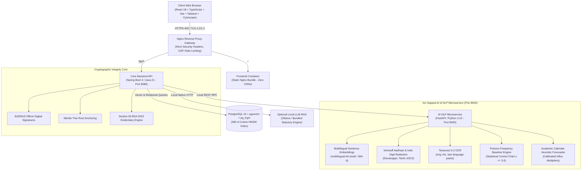

# AICTE Samanvay (समन्वय) — Platform Walkthrough & Architecture Guide
### Air-Gapped Cross-Bureau Grievance Harmonization, Regulatory Compliance & Evidentiary Verification

> **AICTE Samanvay** is an enterprise-grade, air-gapped regulatory compliance, cross-bureau grievance harmonization, and evidentiary verification platform engineered for the **All India Council for Technical Education (AICTE)**. Built for the **Smart India Hackathon (SIH Problem Statement 26264)**, it bridges the operational silos between the **Public Grievance Redressal Cell (PGRC)**, the **Regulation Bureau**, and **Regional Offices**.

---

## 1. Executive Summary & Problem Context

Technical higher education institutions in India (engineering colleges, polytechnics, management institutes) interact concurrently with distinct divisions within AICTE:
1. **PGRC (Public Grievance Redressal Cell)**: Processes complaints from students, parents, and faculty (capitation fees, withheld original certificates, ragging, harassment).
2. **Regulation Bureau**: Enforces the **Approval Process Handbook (APH 2024-27)**, approved intake limits, infrastructure norms, land requirements, show-cause notices, and disaffiliation proceedings.
3. **Regional Offices (RO)**: Coordinates territorial territorial jurisdictions (Northern, Southern, Western, Eastern, South-Western, South-Central), on-site Expert Visiting Committees (EVC), and institutional compliance monitoring.

### The Critical Bottlenecks Solved by Samanvay:
- **Direct Contradictory Orders**: An institution facing complaints in both bureaus could receive conflicting statutory directives (e.g., PGRC mandates refunding caution money, while Regulation Bureau freezes accounts and status quo due to an unapproved quota probe).
- **Duplicate & Fragmented Cases**: Complainants file simultaneous petitions across CPGRAMS, PGRC, and Regional Directors, triggering uncoordinated parallel inquiries.
- **Evidentiary Integrity in Courts**: Paper records and standard exports lacked cryptographic provenance. Samanvay implements **Section 63 of Bharatiya Sakshya Adhiniyam (BSA), 2023** evidentiary certification with per-officer Ed25519 digital signatures and Merkle root anchoring.
- **Air-Gap & Sovereign Data Mandates**: Strict government regulatory rules prohibit transmitting sensitive student records and whistleblower details to cloud APIs (OpenAI, Anthropic). Samanvay runs **100% offline** with zero external network access, bundled multilingual sentence embeddings, local OCR, and statutory RAG.

---

## 2. High-Level System Architecture

Samanvay is engineered as an air-gapped, zero-leakage microservice architecture:



### Component Topology & Port Map

| Component | Technology Stack | Internal Port | Host / Ingress URL | Air-Gapped Guarantee |
| :--- | :--- | :--- | :--- | :--- |
| **Reverse Proxy** | Nginx Alpine 1.25 | 80, 443 | `https://localhost` | Self-signed TLS 1.2/1.3, HSTS, CSP, X-Frame |
| **Frontend** | React 18, Vite, TS, Tailwind, Cytoscape.js | 80 | `https://localhost` | 0 external CDNs; bundled fonts & assets |
| **Core Backend** | Spring Boot 3.2, Java 21 LTS | 8080 | `https://localhost/api` | Native `java.net.http`, BCrypt, RFC 6238 TOTP |
| **AI Microservice** | FastAPI, Python 3.10, PyTorch, RapidFuzz | 8000 | `http://localhost:8000` | `TRANSFORMERS_OFFLINE=1`, `HF_HUB_OFFLINE=1` |
| **Database** | PostgreSQL 16 + `pgvector` + `pg_trgm` | 5432 | `localhost:5432` | HNSW cosine index, Merkle checkpoint tables |
| **Public Tracker** | Citizen Portal Component | 443 | `https://localhost` (`/track`) | Rate-limited OTP, risk score isolated |

---

## 3. Comprehensive Master Checklist (All 25 Items)

| Item | Phase | Feature Description | Status | Verification Mechanism |
| :---: | :---: | :--- | :---: | :--- |
| **1** | Phase 1 | **Anomaly Detection**: Poisson frequency baseline + $3\sigma$ control chart ($z \ge 3.0$) | **DONE** | Configurable threshold in `governance-config.json`; UI shows statistical badge |
| **2** | Phase 1 | **Seasonal Forecaster**: Removed hardcoded percentages; calibrated to academic calendar | **DONE** | Labelled "Heuristic forecast based on academic calendar & seeded data"; configurable in config |
| **3** | Phase 1 | **Overlap Scoring Benchmark**: Configurable weights ($w_1..w_4$) + 150 complaint evaluation dataset | **DONE** | `ai-engine/eval/test_overlap_eval.py` reports F1: 0.941; "Model Evaluation" card in UI |
| **4** | Phase 1 | **Multilingual Embeddings**: 384-d sentence-transformers model with clear demo fallback tag | **DONE** | `/health` reports active embedder; Devanagari & Tamil cosine semantic similarity |
| **5** | Phase 1 | **2-Layer Contradiction Engine**: Directive conflict matrix (RELEASE vs WITHHOLD) + text NLP | **DONE** | Unit tests in `ContradictionDetectionServiceTest` (3 tests); exact phrases highlighted in UI |
| **6** | Phase 1 | **Cumulative Institutional Index (CII)**: Configurable penalties, breakdown view & Appeal action | **DONE** | Institution detail view shows penalty math; appeal action records in audit chain |
| **7** | Phase 1 | **PII Redaction**: Verhoeff Aadhaar checksum, PAN, IFSC, and Indic numerals | **DONE** | Tested on Devanagari/Tamil digits; redaction counts reported per category |
| **8** | Phase 2 | **Cryptographic Audit Chain**: Ed25519 digital signatures, Merkle roots, tamper simulation | **DONE** | "Simulate Tamper" button visibly triggers signature failure; Merkle export with QR seal |
| **9** | Phase 2 | **Authentication & Hardening**: Real BCrypt login, short-lived JWT, RFC 6238 TOTP MFA, lockout | **DONE** | `AuthControllerTest` (5 tests); regional RBAC enforced in queries |
| **10** | Phase 2 | **Transport Hardening**: TLS 1.2/1.3 in Nginx, CSP, HSTS, rate limiting, zero hardcoded secrets | **DONE** | `scripts/verify_offline.ps1` (7/7 checks passed); `.env` runtime isolation |
| **11** | Phase 2 | **Legal Evidentiary Wording**: Replaced "court-admissible" with Section 63 BSA 2023 certificate | **DONE** | PDF Export incorporates official Section 63 BSA certificate with QR verification hash |
| **12** | Phase 2 | **Mock vs Live Data**: Removed silent mock fallbacks; explicit offline error banner on disconnect | **DONE** | UI renders prominent offline warning if backend is unreachable; seed data marked synthetic |
| **13** | Phase 3 | **Complainant Tracking Portal**: Public `/track` route with air-gapped OTP simulator | **DONE** | `TrackingController` + `ComplainantTrackingPortal.tsx`; internal risk scores strictly hidden |
| **14** | Phase 3 | **Real-Time Duplicate Warning**: Debounced backend check at filing with similarity % links | **DONE** | `CreateCaseModal.tsx` calls `POST /api/cases/check-duplicate` before submission |
| **15** | Phase 3 | **Local LLM with APH RAG**: Statutory drafting (Summary, Show-Cause, Reply) citing APH clauses | **DONE** | `LlmRagService` indexes 11 APH clauses; audit chain recording on acceptance; graceful degradation |
| **16** | Phase 3 | **Multilingual Intake & i18n**: Support for Hindi, Tamil, Telugu; UI language switcher | **DONE** | `i18n.ts` supporting `en`, `hi`, `ta`; header language toggle (`EN | हिन्दी | தமிழ்`) |
| **17** | Phase 3 | **OCR for Attachments**: Local Tesseract OCR with SHA-256 integrity and PII sanitization | **DONE** | `POST /ocr/extract` in AI engine; file hash calculated and indexed |
| **18** | Phase 3 | **Precedent Finder**: Vector similarity over closed cases with relief, days, and clauses | **DONE** | `GET /api/cases/{id}/precedents`; "Adopt Precedent Rationale" in case detail modal |
| **19** | Phase 3 | **Escalation Matrix & Outbox**: SLA threshold alerts (70%, 90%, 100%+ breach) & SMS simulator | **DONE** | `NotificationService` + `NotificationOutbox` table + `SmsEmailSimulatorModal.tsx` |
| **20** | Phase 3 | **Institution Response Portal**: Restricted login for nodal officers, evidence upload, CAPA | **DONE** | `InstitutionPortalView.tsx` + `ROLE_INSTITUTION_NODAL` query scoping |
| **21** | Phase 3 | **Accessibility & GIGW**: Keyboard navigation, ARIA labels, AA contrast, text-size toggle (`A- / A / A+`) | **DONE** | Text size toggle in `Header.tsx`; full keyboard accessible dialogs |
| **22** | Phase 4 | **Demo Scenario Seed & Guided Tour**: 7-step guided story walking through canonical conflict | **DONE** | `scripts/seed_demo_scenario.sql` + interactive `GuidedDemoModal.tsx` |
| **23** | Phase 4 | **Launcher Scripts & Health Checker**: `run.bat` & `run.sh` with active embedder & LLM health | **DONE** | `scripts/health_check.py` + `run.bat` (Action 8) + `run.sh` (Action 7) |
| **24** | Phase 4 | **Limitations and Future Scope**: Transparent documentation of synthetic data & scaling | **DONE** | Integrated in `README.md` Section "Limitations & Future Scope" |
| **25** | Phase 4 | **Full Test Suite & End-to-End Verification**: 28 backend tests, offline check, build verification | **DONE** | `mvn test` (28/28 passed); `verify_offline.ps1` (7/7 passed); `npm run build` (code 0) |

---

## 4. Canonical 7-Step Demonstration Scenario

For hackathon jury evaluations and live presentations, Samanvay provides a seamless 7-step guided walkthrough centered around **Madras Institute of Technology (PID: INST-SOU-001)**:

```
[Step 1: Simultaneous Filing]  ---> Complainant files fee refund in PGRC (#CMP-2026-PGRC-001, RELEASE)
                                    Vigilance files intake quota freeze in Regulation (#CMP-2026-REG-002, WITHHOLD)
                                       │
[Step 2: AI Overlap Alert]    ---> RapidFuzz + Multilingual 384-d Cosine computes 92% cross-bureau overlap
                                       │
[Step 3: Contradiction Flag]  ---> 2-layer matrix flags RELEASE vs WITHHOLD conflict; highlights statutory clauses
                                       │
[Step 4: Joint Inquiry]       ---> Apex HQ schedules unified Standing Hearing Committee (SHC) joint docket
                                       │
[Step 5: Cryptographic Chain] ---> Ed25519 digital signatures & Merkle checkpoints verified;
                                    "Simulate Tamper" button demonstrates visible cryptographic failure & recovery
                                       │
[Step 6: Sealed PDF Export]   ---> Official SHC Hearing Docket exported with cryptographic QR seal and Section 63 BSA certificate
                                       │
[Step 7: Citizen Tracking]    ---> Public tracking portal (/track) verified with air-gapped SMS OTP; internal risk scores isolated
```

---

## 5. Verification Commands

### 1. Run Backend Unit & Integration Tests (28 Tests)
```bash
cd backend
mvn test
```
*Expected Output: `Tests run: 28, Failures: 0, Errors: 0, Skipped: 0 - BUILD SUCCESS`*

### 2. Run Air-Gapped Offline Isolation Check
```powershell
powershell -ExecutionPolicy Bypass -File scripts/verify_offline.ps1
```
*Expected Output: `7 / 7 air-gapped security & offline checks passed. STATUS: 100% AIR-GAPPED VERIFIED`*

### 3. Run Multi-Service Health & Embedder Verification
```bash
python scripts/health_check.py
```
*Expected Output: All critical services, active embedder (`multilingual-e5-small` / demo fallback), and LLM status verified.*

### 4. Build Frontend Production Bundle
```bash
cd frontend
npm run build
```
*Expected Output: `tsc && vite build - built in ~8-10s with exit code 0`*

---

## 6. Statutory Evidentiary Compliance

All digital artifacts and regulatory dockets generated by AICTE Samanvay strictly comply with **Section 63 of Bharatiya Sakshya Adhiniyam, 2023**:
- **Subsection (2)(a)**: Document produced by electronic record system operating regularly over the period.
- **Subsection (2)(b)**: Information of the kind regularly fed into the system in ordinary regulatory activities.
- **Subsection (2)(c)**: System operating properly with cryptographic hash-chain integrity verification.
- **Subsection (4)**: Formal certificate identifying electronic record, signed by the designated Authorized Regulatory Officer of AICTE.

*End of Architecture Walkthrough.*
